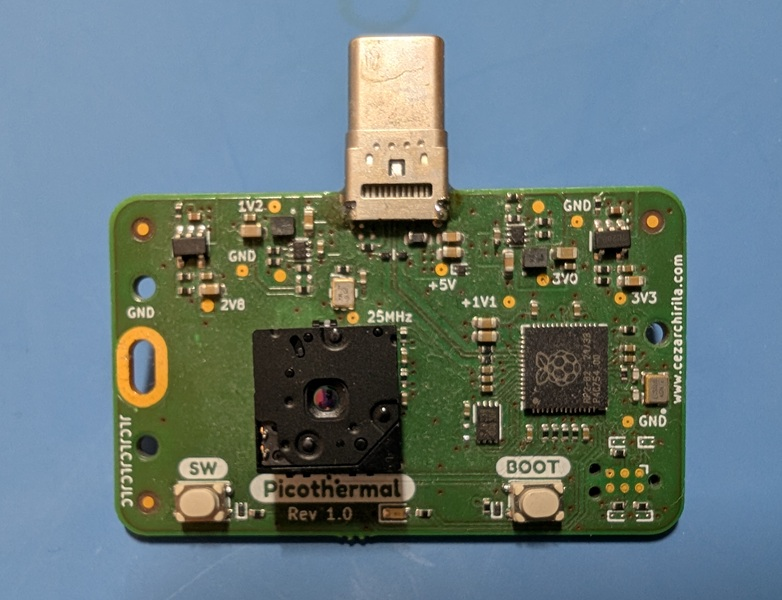
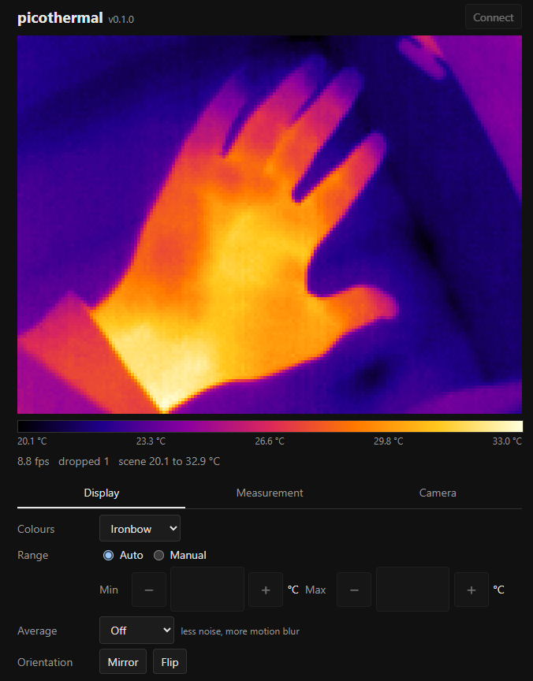

# Introduction

Picothermal is a WebUSB thermal camera based on a Flir Lepton 3.5 sensor that uses a RP2040 and connects to your PC or phone via USB-C. 

It doesn't need any app as it uses WebUSB (which also means it doesn't support Firefox, unfortunately). 

*Top assembly*

[*WebUSB app*](#firmware)

# Hardware

The hardware and software is open-source, see the [picothermal-hardware](picothermal-hardware) folder for the Kicad project, manufacturing files and a PDF schematic. 

There are also STLs available for an enclosure in [enclosure](enclosure). There are two variants for the bottom piece depending on the PCB thickness (0.8mm or 1.6mm).

# Firmware

For firmware, please see [picothermal-fw](https://github.com/icamaster/picothermal-fw).

Initially I wanted to write the software in C, using TinyUSB for the USB protocol. Unfortunately, due to lack of free time, I decided to rewrite this using agents in Rust, using embassy. The end result works quite good, although I expect the code to be pretty unmaintanable since it is mostly agent written.

# License

MIT
